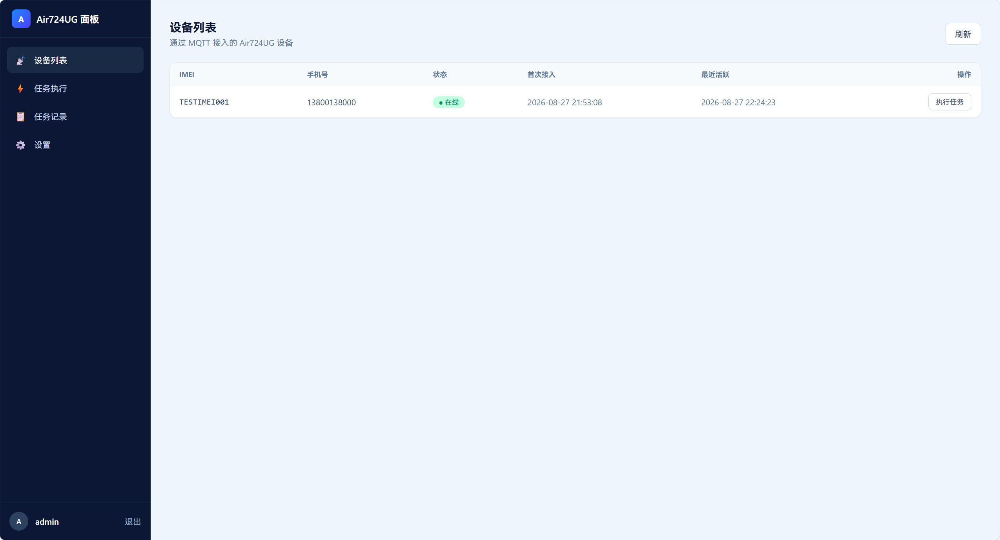
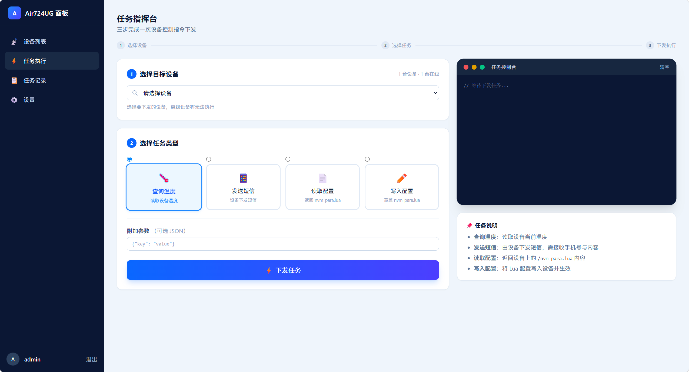
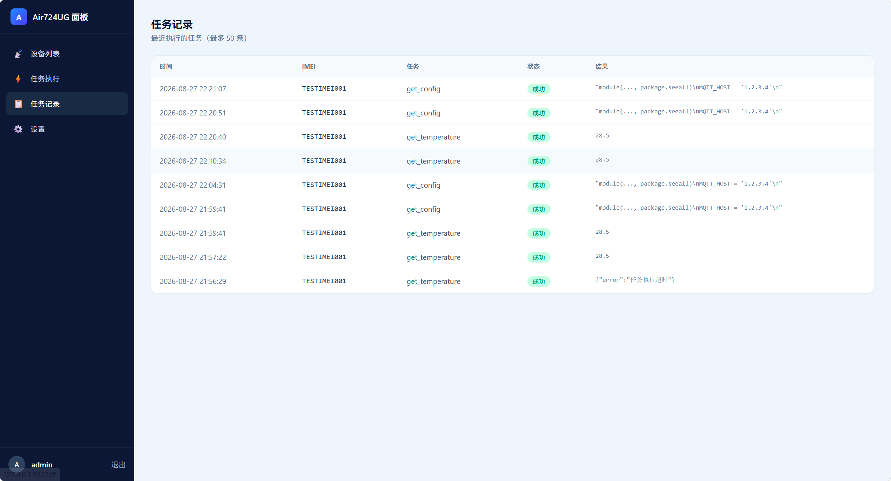

# AirPanel

基于合宙 **Air724UG** 4G 模组（LuatOS-Air）的远程管理面板与短信 / 通话转发器。

本项目由 [vipxkw/AirPanel](https://github.com/vipxkw/AirPanel) **修改而来**，在其基础上扩展了通话 / 短信记录留存、垃圾屏蔽、设备概览（功耗 / 信号 / 续航）、省电模式、RGB 灯光控制、日志中心、原生 iOS 客户端等能力。

服务端为 **Go 单二进制**（内置 HTTP 面板 + MQTT Broker），前端使用 **Tailwind CSS** 构建并以 `go:embed` 内嵌进二进制，相比原 WebSocket 方案显著降低设备流量消耗。

> 请勿用于非法用途及盈利。

## 特性

- **设备远程管理**：设备列表、在线状态、一键下发任务（查询温度 / 发送短信 / 拨打电话 / 读取配置 / 写入配置 / **编辑配置** / 重启等）、删除设备
- **MQTT 接入**：Go 服务端内置 MQTT Broker，设备端经 **MQTT over WebSocket（WSS）** 接入，心跳仅 2 字节、间隔 30s，省流量
- **通话记录 / 短信记录**：设备端自动上报通话（来电 / 去电、接通 / 未接 / 拒接 / 未应答、时长）与短信（收 / 发、内容），服务端 SQLite 留存，面板支持**时间范围与设备筛选、分页查看、单条删除、批量清理**
- **通知状态列**：通话 / 短信记录展示每条记录的 **Bark 通知推送状态**（已推送 / 被屏蔽 / 失败）
- **垃圾屏蔽**：支持**关键字屏蔽**与**号码屏蔽**，内置常见垃圾 / 骚扰规则（默认数据），命中规则后标记为垃圾并**不再发送通知**，记录中标明命中规则
- **设备概览**：实时遥测——信号强度（RSRP / CSQ / RSSI）、功耗、在线时长、当前电压 / 电流、**供电状态（USB / 电池）**、**预估续航**（电池容量可配置，默认 1800mAh），含信号 / 电压 / 温度趋势图
- **省电模式**：设定时段（支持跨天）自动进入低功耗，**半在线 / 彻底离线深睡**两档，可调省电心跳与遥测间隔，支持**立即进入 / 立即退出**
- **RGB 灯光控制**：RGB 灯效 / 氛围灯，**来电 / 短信事件灯光反馈**，矩阵按键（K2/K3）灯效，灯光事件与灯效均可远程配置
- **日志中心**：留存设备上报的全部日志（上线 / 遥测 / 结果 / 通知等），分页展示、多条件筛选、**单条日志单行截断 + hover 浮动显示完整 JSON + 一键复制**，**超 7 天自动清理**
- **一键重启服务端**：顶部"重启"按钮，调用 `/api/restart` 后台重启服务并自动恢复
- **定时任务**：宝塔面板式计划任务，支持每周 / 每月 / 每天 / 每小时 / 每 N 分钟 / 每 N 小时周期自动下发，设备离线时静默跳过该次执行
- **远程配置**：读取 / 写入设备端 `nvm_para.lua` 参数文件，支持动态修改设备配置
- **多通道通知**：设备端支持 gotify / telegram / bark / 钉钉 / 飞书 / 企业微信 / pushover / message-pusher 等通知渠道
- **Bark 定制**：主标题（自动取发件人 / 来电号码）、自定义图标（icon）、分组（默认 `汉中移动`）、推送声音（默认 `glass`）、精简内容、设备重启时附加原因信息
- **离线通知**：服务端通过心跳超时或连接断开判定设备离线，支持 13 个通知渠道推送离线告警
- **断线自愈**：设备端连接失败指数退避重连（5s→60s 封顶），内置双重看门狗，服务端重部署后设备自动恢复连接
- **单二进制部署**：前端静态资源通过 `go:embed` 内嵌进 Go 二进制，支持 Docker 一键部署
- **PWA 现代 UI**：Tailwind 现代化界面、移动端适配，支持 **iOS「添加到主屏幕」** 以全屏方式运行
- **原生 iOS 客户端**：`AirPanel-iOS-v2`（iOS 26+，当前版本；旧版 `archive/AirPanel-iOS`），配置服务端 API 地址 + 账号密码登录，作为独立客户端操作面板全部功能

## 界面预览

### 设备列表



### 任务执行



### 任务记录



### 设置界面


## 系统架构

```
┌────────────┐   wss://host/websocket  ┌──────────────────────────────┐
│ Air724UG   │ ◄──────(443 加密)──────►│        nginx / xray (443)    │
│ 设备端Lua  │    MQTT over WebSocket   │  /websocket ──┐              │
│ 固件 script│    cmd/{imei} 等主题      │  /  ──────────┼────────────┐ │
└────────────┘                          │              ▼            │ │
                                        │  ┌──────────────────────┐ │ │
                                        │  │   panel-server :9527 │ │ │
                                        │  │ ┌───────┐ ┌────────┐ │ │ │
                                        │  │ │ MQTT  │ │ HTTP   │ │ │ │
                                        │  │ │ Broker│ │ 面板    │ │ │ │
                                        │  │ │ (WS)  │ │ REST+前端│ │ │ │
                                        │  │ └───────┘ └────────┘ │ │ │
                                        │  │        │ SQLite      │ │ │
                                        │  └────────┴─────────────┘ │ │
                                        └──────────────────────────┘ ┘
```

- 公网仅开放 **一个端口**：443 终结 TLS（`/websocket` 与 `/` 都反代到 `panel-server` 的 **9527** 端口）——MQTT over WSS 与 Web 面板共用同一端口，无需再暴露 1883/8083
- 设备经 **wss（443）** 接入，MQTT 数据封装在 WebSocket 帧中传输，加密且省流量；内网也可用 `ws://host:9527/websocket` 直连，或可选启用 MQTT TCP 内网直连
- 设备订阅 `cmd/{imei}` 接收指令，上报 `device/{imei}/online`（上线）、`device/{imei}/result`（任务结果）、`device/{imei}/telemetry`（遥测）等；服务端将任意 `device/` 前缀上报写入日志中心留存
- 面板通过 REST API 下发任务，服务端转 MQTT 推送给设备并等待回报（30 秒超时）

## 目录结构

```
AirPanel/
├── Air724ug/             # Air724UG 设备端 Lua 固件（LuatOS-Air）
│   ├── core/             # 底层固件包（.pac）
│   └── script/
│       ├── main.lua      # 入口：初始化、MQTT/通知/省电/监听启动
│       ├── config.lua    # 设备端默认配置（通知/MQTT/省电/Bark/指示灯等，含注释示例）
│       ├── nvm_para.lua  # 设备端参数文件【参考模板】（可写入配置的示例）
│       ├── lib/          # 底层库（nvm / mqtt / websocket / sys / led / led_rgb / netLed 等）
│       ├── utils/        # 功能模块（util_mqtt / util_notify / util_mobile / util_record / util_block / util_powersave / util_temperature / util_http 等）
│       ├── handler/      # 事件处理（handler_sms 短信 / handler_call 来电 / handler_powerkey 电源键菜单）
│       └── audio/        # 语音 / 提示音资源
├── server-go-v2/         # Go 服务端（当前主版本，Docker 镜像由它构建）
├── AirPanel-iOS-v2/      # iOS 26+ 原生客户端（当前版本，SwiftUI + Liquid Glass）
├── archive/              # 归档：已被 v2 取代的旧实现，仅留作参考
│   ├── server-go/        # Go 服务端 v1（main.go / api.go / broker.go / static/ 前端…）
│   └── AirPanel-iOS/     # iOS 客户端 v1（Swift，连接面板 API）
├── screenshots/          # 界面截图
├── docker-compose.yml    # Docker 一键部署
└── README.md
```

## 快速开始（Go 服务端）

> 下面这一节讲的是**已归档**的 v1 服务端 `archive/server-go`（路径已随之调整）。
> 当前主版本是 `server-go-v2`，构建与部署见 `server-go-v2/README.md`。

### 本地运行

前置：Go 1.22+（本项目使用纯 Go 的 `modernc.org/sqlite`，无需 CGO）。

```bash
cd archive/server-go
go build -o panel-server.exe .
./panel-server.exe
```

默认配置：

- HTTP 面板 + MQTT over WebSocket（`/websocket`）：`http://127.0.0.1:9527`（单端口）
- 默认账号：`admin / admin123`（可在面板「设置」中修改用户名/密码，或编辑 `config.json`）；登录 Token 有效期 2 个月

### 前端修改（改动 static/ 后需重新构建）

前端资源在 `archive/server-go/static/`（页面、JS、CSS），编译时通过 `go:embed` 内嵌进二进制，改动后重新 `go build` 即生效：

```powershell
cd archive/server-go
go build -o panel-server.exe .
```

> `static/css/style.css` 为 Tailwind 编译产物，缺少的工具类请用内联样式或手动补齐。

### Docker 部署

**方式一：本地构建 + docker-compose**

```bash
docker-compose up -d
```

`docker-compose.yml` 仅发布 `9527`（HTTP 面板 + MQTT over WebSocket 共用），SQLite 数据库与 `config.json` 通过卷 `panel-data` 持久化到容器 `/app/data/` 下。

**方式二：Dockerfile 构建**

```bash
cd archive/server-go
docker build -t airpanel .
docker run -d --name airpanel --restart unless-stopped \
  -p 9527:9527 \
  -v panel-data:/app/data \
  airpanel
```

- `-p 9527` HTTP 面板 + MQTT over WebSocket（`/websocket`）共用，**只需这一个端口**
- `-v panel-data:/app/data` SQLite 数据与 `config.json` 配置统一持久化到命名卷；首次启动自动生成默认配置（账号 `admin / admin123`），升级容器不丢失配置

> **低配服务器提示**：若服务器资源紧张（尤其 Docker 构建易卡爆），可直接在本地交叉编译 Linux 二进制上传运行（`GOOS=linux GOARCH=amd64 CGO_ENABLED=0 go build`），再用 `start.sh` 一键后台启动，无需 Docker。

### 服务器部署（本地交叉编译 + 一键启动）

适合低配 / 无 Docker 的服务器，也是本项目实际采用的部署方式：

```powershell
# 本地交叉编译 Linux amd64 二进制
cd archive/server-go
$env:GOOS="linux"; $env:GOARCH="amd64"; $env:CGO_ENABLED="0"
go build -o panel-server-linux .
# 上传至服务器 /root/airpanel/panel-server（或用 deploy_panel.py 自动完成）
```

服务器上 `start.sh` 一键启动并后台运行（停止旧进程 → 等待端口释放 → setsid nohup 启动 → 验证监听与日志）：

```bash
bash /root/airpanel/start.sh
```

> `deploy_panel.py` 封装了 sftp 上传（临时名 + mv 避免覆盖运行中二进制）与调用 `start.sh` 重启，内含敏感信息不入库 git。

### WSS 加密接入（推荐，公网部署）

MQTT over WebSocket 与 Web 面板共享 `9527` 端口（路径 `/websocket`）。公网部署用 nginx 做 TLS 终结并反代，设备以 `wss://你的域名/websocket` 一条链接接入，全程加密：

```nginx
server {
    listen 443 ssl;
    server_name panel.example.com;

    ssl_certificate     /etc/nginx/ssl/fullchain.pem;   # 你的证书
    ssl_certificate_key /etc/nginx/ssl/privkey.pem;

    # 设备 MQTT over WSS：/websocket -> 127.0.0.1:9527
    location /websocket {
        proxy_pass http://127.0.0.1:9527;
        proxy_http_version 1.1;
        proxy_set_header Upgrade $http_upgrade;
        proxy_set_header Connection "upgrade";
        proxy_read_timeout 3600s;
    }

    # Web 面板
    location / {
        proxy_pass http://127.0.0.1:9527;
    }
}
```

> 证书可用 `acme.sh` 申请并配置到 nginx（本例证书置于 `panel-server/certs/` 便于随服务迁移），建议挂 cron 定期自动续期。
> 若 80/443 与 Go 服务端不在同一台机器，把 `proxy_pass` 指向服务端 IP 即可；仅需开放 443，**无需**再暴露任何其它端口。

## 设备端固件对接

1. 将 `Air724ug/script/` 目录内容按原结构烧录到设备（底层固件见 `Air724ug/core/`）
2. 在 `Air724ug/script/config.lua` 中配置服务端地址，**推荐单链接 `MQTT_URL`**（一条链接搞定）：

```lua
-- 公网（推荐）：wss 加密，nginx 反代 443 → 面板端口 /websocket
MQTT_URL = "wss://panel.example.com/websocket"
-- 内网明文 WebSocket（直接连面板端口）：
-- MQTT_URL = "ws://192.168.1.100:9527/websocket"
-- 内网 MQTT TCP（需服务端 config.json 中 mqtt.port > 0 启用）：
-- MQTT_URL = "mqtt://192.168.1.100:1883"

MQTT_KEEPALIVE = 30    -- 心跳间隔（秒），仅在此间隔发 2 字节心跳包，可降低流量
```

> 也兼容旧参数 `MQTT_HOST` / `MQTT_PORT`（TCP 明文，`MQTT_URL` 留空时生效）。

3. `main.lua` 检测到 `MQTT_URL` 或 `MQTT_HOST` 任一非空即自动启动 MQTT 连接；同时需配置一个通知渠道（如 gotify / bark）用于接收设备事件。

### 断线重连与自愈机制

- **重连指数退避**：连接失败后按 5s→10s→20s→40s→60s（封顶）间隔重试；服务端恢复后最多 60 秒内自动重连
- **静默断开检测**：超过 2 个 keepalive 周期未收到服务端任何数据即判定断线，主动重连
- **应用层心跳**：按 `HEARTBEAT_INTERVAL`（默认 120 秒）周期上报 `device/{imei}/online`，服务端据此判定在线状态
- **双重看门狗**：`MQTT_STUCK_TIMEOUT`（假死，默认 5 分钟）/ `MQTT_REBOOT_TIMEOUT`（持续连不上，默认 15 分钟），自动重启模块自愈；置 0 可关闭
- **开机通知带原因**：开机推送显示重启原因（按键开机 / 充电开机 / 软件重启 / 异常复位）

### 省电模式

设备端在 `config.lua` 配置，Web 面板「基本设置 → 省电模式」可视化编辑并远程下发：

```lua
POWERSAVE_ENABLE    = false     -- 省电开关，开启后时段内进入低功耗
POWERSAVE_START_HOUR= 1         -- 开始小时（0-23）
POWERSAVE_END_HOUR  = 8         -- 结束小时（0-23），支持跨天（22→8 表示夜间至次日 8 点）
POWERSAVE_DEEP      = false     -- false=半在线；true=彻底离线深睡
POWERSAVE_HEARTBEAT = 600000    -- 半在线省电心跳间隔（毫秒）
POWERSAVE_TELEMETRY = 0         -- 省电遥测间隔（毫秒），0 表示暂停遥测
```

- **半在线（推荐）**：保持 MQTT 在线，仅停周期任务 / 关灯 / 拉长心跳，短信来电不丢失
- **彻底离线深睡**：进入飞行模式断网、射频全关最省电，但夜间失联，短信存 SIM 卡醒来补收、来电会丢失

面板支持 **立即进入 / 立即退出** 省电（按当前档位下发并保存配置）。

### 设备端参数文件 nvm_para.lua

设备端掉电保存的实时参数文件（`/nvm_para.lua`），优先级高于 `config.lua`。仓库内 `Air724ug/script/nvm_para.lua` 提供了**全部可写参数的注释示例**，可直接复制到面板「任务执行 → 写入配置」中使用，支持远程配置：

- **通知方式**：`NOTIFY_TYPE` 及 gotify/telegram/bark/钉钉/飞书/企业微信等渠道参数（Bark 含 `BARK_TITLE`/`BARK_ICON`/`BARK_GROUP`/`BARK_SOUND`）
- **MQTT 参数**：`MQTT_URL` / `MQTT_HOST` / `MQTT_PORT` / `MQTT_KEEPALIVE` / `HEARTBEAT_INTERVAL`
- **省电参数**：`POWERSAVE_ENABLE` / `POWERSAVE_START_HOUR` / `POWERSAVE_END_HOUR` / `POWERSAVE_DEEP` / `POWERSAVE_HEARTBEAT` / `POWERSAVE_TELEMETRY`
- **自愈参数**：`MQTT_STUCK_TIMEOUT` / `MQTT_REBOOT_TIMEOUT`（0 关闭）
- 音量、来电动作、短信播报、开机通知、网卡、指示灯（`LED_ENABLE`）、SIM pin、录音上传地址等

> 生效规则：固件用 `nvm.get()` 读取的参数（音量/来电动作/短信播报/开机通知等）写入后**重启持久生效**；用 `config.xxx` 读取的参数（MQTT 地址/通知渠道）写入后**当前运行立即生效**。

## Web 面板功能

- **设备列表**：IMEI / 备注 / 手机号 / 在线状态 / 接入时间，支持在线编辑备注、跳转执行任务、删除设备
- **设备概览**：信号强度（RSRP / CSQ / RSSI）、功耗、在线时长、当前电压 / 电流、供电状态（USB / 电池）、预估续航（电池容量可配置，默认 1800mAh），信号 / 电压 / 温度趋势图与设备信息并列
- **任务执行**：三步向导式指挥台（选择设备 → 选择任务类型 → 下发执行），内置终端风格实时控制台；任务类型含查询温度 / 发送短信 / 拨打电话 / 读取配置 / 写入配置 / **编辑配置** / 重启等
- **定时任务**：宝塔面板式计划任务管理（新增 / 编辑 / 启停 / 删除 / 立即执行），设备离线时静默跳过
- **任务记录**：执行记录分页查看（成功/失败 + 结果详情，可清理旧日志）
- **通话记录**：通话历史（来电 / 去电、接通 / 未接 / 拒接 / 未应答、时长），支持时间范围与设备筛选、分页、单条删除、清理；展示通知推送状态与垃圾标记（命中规则）
- **短信记录**：短信历史（收 / 发、内容），支持时间范围与设备筛选、分页、单条删除、清理；展示通知推送状态与垃圾标记（命中规则）
- **屏蔽配置**：关键字屏蔽与号码屏蔽规则管理（新增 / 编辑 / 删除 / 重置，含分页），内置默认垃圾规则；命中规则后不再发送通知
- **日志中心**：设备上报的全部日志（时间 / 类型 / 设备 / 内容），支持时间 / 设备 / 类型 / 关键字筛选、分页，**单条日志单行截断、hover 浮动显示完整 JSON、一键复制**，**超 7 天自动清理**
- **灯光控制**（基本设置）：状态指示灯与 RGB 灯效管理、事件灯光反馈（来电 / 短信）、矩阵按键灯效，灯光事件与灯效远程下发
- **省电模式**（基本设置）：时段、档位、心跳 / 遥测间隔配置，开关按钮（绿=关 / 黄=开）与立即进入 / 立即退出
- **设置**：Tab 式设置页——登录账号、离线通知（开关 / 渠道配置 / 测试通知）、Bark 推送参数、界面设置（站点标题 / Logo 自定义）
- **顶部栏**：Logo hover 显示服务已运行时长；"重启"按钮一键重启服务端；"退出"退出登录

## iOS 客户端（archive/AirPanel-iOS，旧版）

`archive/AirPanel-iOS/` 是原生 **Swift** 客户端（非 WebView 壳），作为**服务端连接工具**：启动时配置面板 API 地址，输入账号密码登录后即可操作面板全部功能（设备概览、任务下发、通话 / 短信 / 日志记录、屏蔽配置、省电、灯光等），适配 iOS 主屏幕运行，可侧载未签名 IPA 体验。

> 客户端直接调用 Web 面板的 REST API（`/api/*`），需服务端可被 iOS 设备访问；登录 Token 有效期 2 个月。

## API 一览

| 方法 | 路径 | 说明 | 鉴权 |
| --- | --- | --- | --- |
| POST | `/api/login` | 登录，返回 JWT（有效期 2 个月） | 否 |
| POST | `/api/logout` | 退出登录 | 是 |
| POST | `/api/change-user-info` | 修改用户名/密码 | 是 |
| GET | `/api/userPool` | 设备列表 | 是 |
| POST | `/api/device/remark` | 设置设备备注 | 是 |
| POST | `/api/device/delete` | 删除设备 | 是 |
| GET | `/api/device/overview` | 设备概览（信号/功耗/在线时长/电流/供电状态/续航/遥测） | 是 |
| POST | `/api/device/overview/config` | 保存概览配置（如电池容量） | 是 |
| POST | `/api/executeTask` | 下发任务（含拨打电话 `dial_call`、编辑配置 `edit_config` 等） | 是 |
| GET | `/api/tasks` | 任务记录（分页） | 是 |
| POST | `/api/tasks/clear` | 清理任务记录 | 是 |
| GET | `/api/schedules` | 定时任务列表（分页） | 是 |
| POST | `/api/schedules/add` | 新增定时任务 | 是 |
| POST | `/api/schedules/update` | 编辑定时任务 | 是 |
| POST | `/api/schedules/toggle` | 启用 / 停用定时任务 | 是 |
| POST | `/api/schedules/delete` | 删除定时任务 | 是 |
| POST | `/api/schedules/run` | 立即执行一次定时任务 | 是 |
| GET | `/api/settings` | 读取面板设置 | 是 |
| POST | `/api/settings/save` | 保存面板设置 | 是 |
| GET | `/api/notify/channels` | 获取通知渠道定义 | 是 |
| POST | `/api/notify/test` | 发送测试通知 | 是 |
| GET | `/api/calls` | 通话记录（分页；`from/to`、`imei` 筛选） | 是 |
| POST | `/api/calls/clear` | 清理通话记录 | 是 |
| POST | `/api/calls/delete` | 删除单条通话记录 | 是 |
| GET | `/api/sms` | 短信记录（分页；`from/to`、`imei` 筛选） | 是 |
| POST | `/api/sms/clear` | 清理短信记录 | 是 |
| POST | `/api/sms/delete` | 删除单条短信记录 | 是 |
| GET | `/api/logs` | 日志记录（分页；`from/to`、`imei`、`type`、`keyword` 筛选） | 是 |
| POST | `/api/logs/clear` | 清理日志（`days` 天前，`<=0` 全清） | 是 |
| GET | `/api/block-rules` | 屏蔽规则列表（分页） | 是 |
| POST | `/api/block-rules/add` | 新增屏蔽规则 | 是 |
| POST | `/api/block-rules/update` | 编辑屏蔽规则 | 是 |
| POST | `/api/block-rules/delete` | 删除屏蔽规则 | 是 |
| POST | `/api/block-rules/reset` | 重置为内置默认规则 | 是 |
| GET | `/api/health` | 健康检查（含 `uptimeSec` 运行时长） | 否 |
| POST | `/api/restart` | 重启服务端（调用 `start.sh`） | 是 |
| WS | `/websocket` | MQTT over WebSocket（设备接入） | - |

## 服务端配置（config.json）

```json
{
  "jwtSecret": "会话签名密钥",
  "user": { "username": "登录用户名", "password": "bcrypt 密文" },
  "tokenVersion": 1,
  "port": 9527,
  "mqtt": { "host": "0.0.0.0", "port": 0 },
  "dbPath": "panel.db"
}
```

- `mqtt.port`：MQTT TCP 监听端口，0 表示不启用；公网默认只走 WebSocket/WSS（与面板共享 9527，路径 `/websocket`）
- 账号、离线通知、屏蔽规则、概览配置等存储在 SQLite（首次启动自动从 `config.json` 迁移账号），面板「设置」中修改即时生效

## 模拟设备联调（无实体设备）

`archive/server-go/sim_device_ws.py`：通过 MQTT over WebSocket 模拟接入（验证 wss 链路），依赖 `paho-mqtt`

```bash
cd archive/server-go
python sim_device_ws.py
```

> 脚本默认连公网 wss（`panel.example.com:443`），内网联调请改为 `BROKER = "127.0.0.1"`、`WS_PORT = 9527`、`USE_TLS = False`。

## 致谢与许可

本项目基于 [vipxkw/AirPanel](https://github.com/vipxkw/AirPanel) 修改而来，感谢原作者的开源贡献。

> 本项目仅供学习与技术研究，请勿用于非法用途及盈利。
